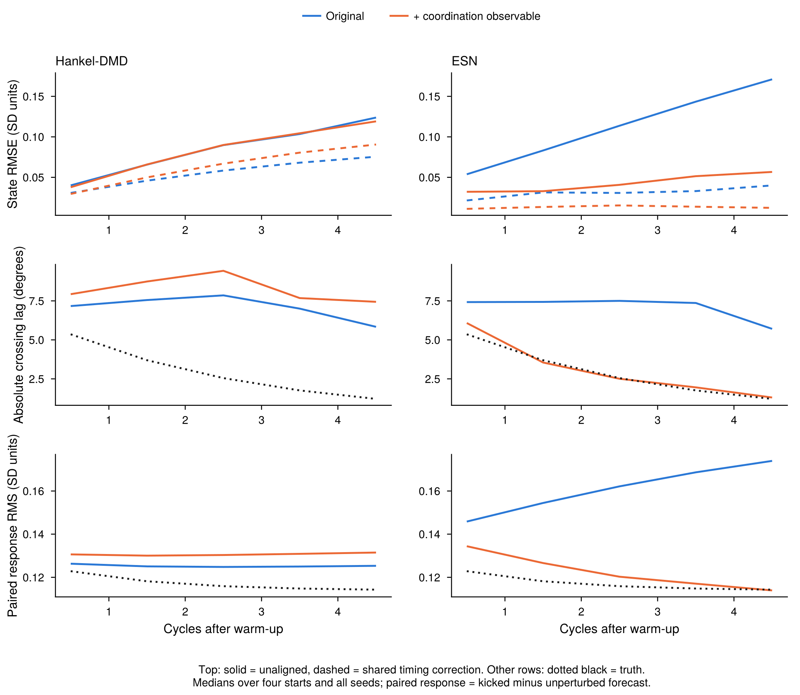

# Coordination and timing checks

Same held-out kicks, 170-sample warm-up, all four starts and all fitted seeds. Original training data and independently generated validation trajectories are unchanged. Parameter regime: ε=0.25, k=0.024935888168402018.

The extra channel is raw w₁−w₂, centered and scaled by its **training** standard deviation. This supplies no new information; it changes the fitting metric, POD basis, regularization geometry and (for ESN) reservoir inputs. Both conditions use the same hyperparameter grid and are selected by the same four-state validation MSE. It is an ablation of this representation, not a claim about every possible weighting.

| Fit | Validation MSE | Median w₁ / w₂ period (true-cycle units) | Final-bin raw / aligned RMSE | Final-bin crossing-lag error (degrees) | Final-bin paired-response error | Failed starts |
|---|---:|---|---|---:|---:|---:|
| dmd | 0.00866 | 0.99810 / 0.99554 | 0.12383 / 0.07549 | 5.874 | 0.04276 | 0 |
| dmd_coordination | 0.00883 | 0.99877 / 0.99520 | 0.11914 / 0.09057 | 7.478 | 0.04934 | 0 |
| esn | 0.00762 | 0.99817 / 0.99576 | 0.17105 / 0.04003 | 4.031 | 0.07281 | 0 |
| esn_coordination | 0.00673 | 0.99917 / 0.99821 | 0.05670 / 0.01233 | 1.361 | 0.01786 | 0 |

Periods are median intervals between upward crossings of a fixed true-cycle mean threshold in each w coordinate, measured over seven cycles. Crossing lag uses the nearest w₂ crossing to each w₁ crossing and is an event-timing proxy, not an asymptotic phase estimate. The plot shows absolute lag; the table compares signed predicted and true lag before taking absolute error.

Timing correction searches ±0.2 cycle at 0.1-sample resolution separately in each cycle bin, applying **one shared shift to all four coordinates** and no amplitude adjustment. This allows common timing drift; it does not independently align the two oscillators. The first quarter-cycle is excluded from the first-bin RMSE in both comparisons to provide symmetric interpolation support.

Paired responses subtract each model's own unperturbed forecast from its kicked forecast, with identical elapsed time and no independent alignment. This removes baseline waveform mismatch but includes any persistent phase reset, so response magnitude need not decay to zero. The table reports error against the true paired response, not just its magnitude. These are conditional forecasts after observing about 1.55 cycles of post-kick history, not predictions from the instant of the kick.

Crossing thresholds are transformed consistently into training-standardized coordinates; this gives the same crossing times as using raw coordinates. RMSE uses the four training-standardized states. No test trajectory is used for model selection.

For this comparison, extra-observable training substantially improves ESN timing and paired-response accuracy, while DMD gains no consistent recovery benefit. Shared timing correction also removes much of the original ESN's pointwise waveform error. These results do not support treating the original difference trace as evidence that either model class is inherently unable to learn recovery.

