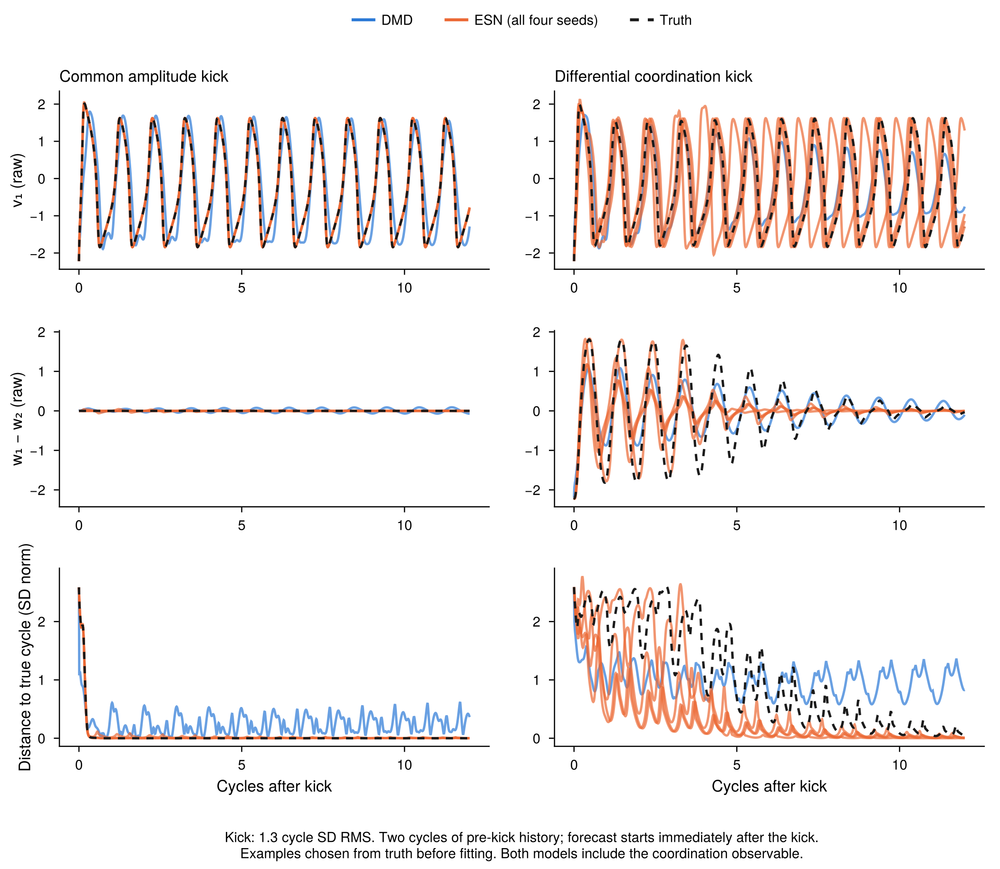

# Larger, covered perturbations

Smoother FHN, ε=0.25, k=0.024935888168402018. This is a synthetic feasibility experiment, not a calibration to human gait. Time is in cycles. No measurement or process noise is added in this first larger-kick experiment.

Training: 24 independent phase/amplitude draws (seed 3101), 12 common amplitude kicks and 12 differential kicks, with magnitudes uniformly sampled from 0.4–1.6 cycle SD RMS per coordinate. Each sequence includes two pre-kick cycles and eight recovery cycles. Validation: eight independent draws (seed 3102) from the same distribution, scored over the first five post-kick cycles. Test: 16 held-out combinations, four phases × two magnitudes (0.8, 1.3) × two families. Test settings lie within the sampled phase/amplitude domain; finite training coverage is not a guarantee of interpolation accuracy.

Common kicks point radially outward from the cycle mean in standardized (v,w) coordinates for both oscillators. Differential kicks apply opposite directions to the two oscillators. These labels describe the applied displacement, not pure dynamical modes.

Initialization uses two cycles of undisturbed history, replaces only its newest observation with the kicked state, then predicts from the next sample. There is **no post-kick teacher forcing**. Training omits the externally imposed pre-kick → kicked transition from autonomous regression targets, but includes kicked histories and subsequent recovery transitions. Training-only state normalization and a standardized w₁−w₂ channel are used for both models. DMD eigenvalues outside the unit circle are clipped.

The two plotted examples maximize true first-three-cycle excursion within their respective held-out families, selected before fitting (both amplitude 1.3, phase index 721). All test cases enter the following numerical summary. Every fitted seed is shown, with failures counted rather than plotted as successful trajectories.

| Model | Family | Median first-5-cycle state RMSE | Median final-cycle distance | Failed / total |
|---|---|---:|---:|---|
| dmd | amplitude | 0.2961 | 0.2853 | 0 / 8 |
| dmd | coordination | 0.6898 | 0.8074 | 0 / 8 |
| esn | amplitude | 0.0275 | 0.0040 | 0 / 32 |
| esn | coordination | 0.9585 | 0.0140 | 0 / 32 |

State RMSE uses training-standardized coordinates and includes timing error; cycle distance is the nearest-point Euclidean norm to the closed true-cycle polyline and is insensitive to shared cycle phase. Forecasts last 12 cycles; independent truth simulations last 30 cycles to check eventual return. No model-specific attractor is used as the distance reference.

True final (30th) cycle distance range for amplitude: (4.514037911532321e-6, 2.0764181599334033e-5).

True final (30th) cycle distance range for coordination: (1.244300073329529e-5, 0.0001628619360659794).

Selected dmd settings: `(τ = 110, r = 120, ridge = 0.0001)`; validation MSE = 0.3726072484755222.

Selected esn settings: `(N = 400, ρ = 0.6, α = 0.5, λ = 0.0001)`; validation MSE = 0.2393662903503267.

